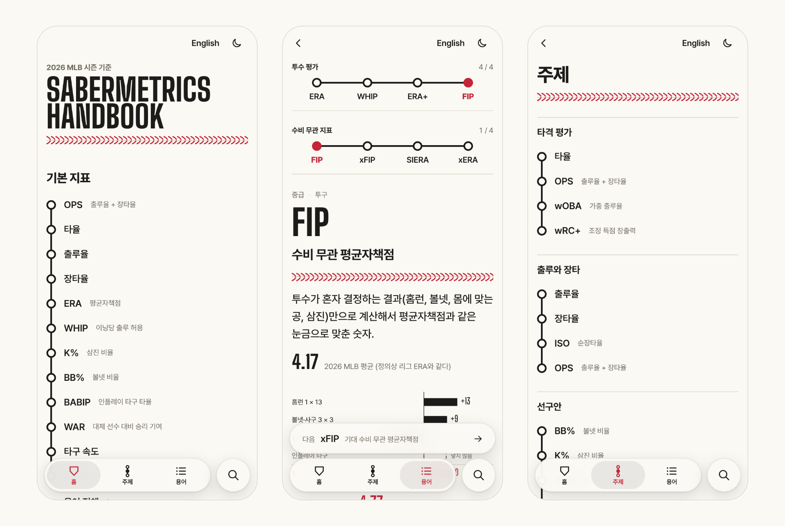

<a href="https://sabermetrics-handbook.pages.dev/">
  <picture>
    <source media="(prefers-color-scheme: dark)" srcset=".github/assets/banner-dark.png">
    
  </picture>
</a>

<p align="center">
  <a href="https://sabermetrics-handbook.pages.dev/"><b>핸드북 열기</b></a> ·
  <a href="https://sabermetrics-handbook.pages.dev/en/">English</a> ·
  <a href="README.md">README in English</a> ·
  <a href="CONTRIBUTING.md">기여하기 (영어)</a>
</p>

<p align="center">
  <a href="https://sabermetrics-handbook.pages.dev/"></a>
  
  
  <a href="https://astro.build"></a>
  
</p>

타율부터 스윙 타이밍까지, 야구 기록 용어를 정리한 사전이다. 용어마다 두 번 쓴다. 처음 보는 사람을 위한 쉬운 설명, 이미 쓰는 사람을 위해 어떻게 계산하고 어디서 틀리는지까지 적은 자세한 설명이다. 한국어와 영어로 같은 내용을 읽을 수 있다.

<picture>
  <source media="(prefers-color-scheme: dark)" srcset=".github/assets/screens-ko-dark.png">
  
</picture>

## 들어 있는 것

- **용어마다 두 겹.** 쉬운 설명과 자세한 설명. 어느 쪽을 먼저 볼지 고를 수 있고, 고른 것은 기억한다.
- **주제.** 관련 용어를 기본에서 심화 순으로 이어 둬서 한 칸씩 따라갈 수 있다(ERA → WHIP → ERA+ → FIP). 읽은 용어는 선 위에 실밥 공으로, 이어 읽은 구간은 빨간 선으로 보인다. 기록은 그 브라우저에만 남는다.
- **수치 기준.** 2026 MLB 평균과 좋고 나쁨의 대략적인 구간을 눈금으로 보여 준다. 숫자마다 출처를 단다.
- **용어마다 그림.** 그 지표를 가장 잘 설명하는 방식으로 하나씩 그렸다. 비율이 세는 타석, 스트라이크 존, 타구 속도 × 발사각, 옆에서 본 투구, 위에서 본 구장, 값이 더해지는 모양 같은 것이다. 페이지에 들어 있는 선화이고, 숫자는 정의상의 경계, 확인한 평균, 가상의 예라고 밝힌 것만 쓴다.
- **최근 Statcast 지표.** 배트 스피드, 스윙 길이, 어택 디렉션, 팔 각도, 스윙 타이밍, 2026년 ABS 챌린지까지 다룬다.
- **한국어와 영어, 라이트와 다크.** 어느 페이지에서든 언어를 바꾸면 같은 용어로 간다. 다크 모드는 완전한 검정이다.
- **앱처럼 설치.** 설정의 ‘앱 설치’를 누르면 된다(iPhone은 홈 화면에 추가하는 방법을 알려 준다). 설치하면 인터넷이 없어도 모든 페이지, 글꼴, 검색이 되고, 아이콘을 길게 누르면 주제, 용어, 다른 언어로 바로 간다. Android·iOS 앱도 같은 빌드를 쓴다.

## 용어

주제 18개에 용어 62개. 한 용어가 여러 주제에 들어가기도 한다.

| 주제 | 기본에서 심화로 |
| --- | --- |
| 타격 평가 | 타율 → OPS → wOBA → wRC+ |
| 출루와 장타 | 출루율 → 장타율 → ISO → OPS |
| 선구안 | BB% → K% → 체이스% → 헛스윙% |
| 타구의 질 | 타구 속도 → 발사각 → 하드히트% → 스위트 스팟% → 배럴 |
| 운과 실력 | BABIP → xBA → xwOBA → xERA |
| 스윙 분석 | 배트 스피드 → 스윙 길이 → 블라스트 → 어택 앵글 → 스윙 타이밍 |
| 스윙 궤적 | 어택 앵글 → 어택 디렉션 → 스윙 틸트 → 스퀘어드업% |
| 주루 | 스프린트 스피드 → 주루 득점 가치 → BsR |
| 투수 평가 | ERA → WHIP → ERA+ → FIP |
| 수비 무관 지표 | FIP → xFIP → SIERA → xERA |
| 삼진과 헛스윙 | K% → K-BB% → CSW% → 헛스윙% |
| 구위 분석 | 구속 → 회전수 → IVB → VAA → Stuff+ |
| 릴리스와 회전 | 익스텐션 → 팔 각도 → 회전수 → 액티브 스핀 |
| 투구 모델 | Stuff+ → Location+ → Pitching+ |
| 수비 평가 | 수비율 → 송구 속도 → OAA → DRS → FRV |
| 포수 수비 | 팝 타임 → 블로킹 → 프레이밍 → ABS 챌린지 |
| 선수 가치 | wRC+ → WAR |
| 상황과 승리 | RE24 → WPA → LI |

## 시작하기

Node 22.22 이상이 필요하다.

```sh
npm install
npm run dev        # 개발 서버 http://localhost:4321 (영어는 /en/)
npm run build      # 정적 빌드 → dist/. 콘텐츠 검사에 걸리면 실패한다
npm test           # 콘텐츠 검사와 단위 테스트 (빌드 없이)
npm run check      # 타입 검사
```

Android·iOS 프로젝트는 같은 사이트를 [Capacitor](https://capacitorjs.com)로 감싼다.

```sh
npm run cap:sync       # 앱용 빌드(dist-app/)를 android/, ios/에 복사
npx cap open android   # 또는 npx cap open ios
npm run icons          # assets/icon.svg, public/favicon.svg로 PWA·앱 아이콘을 다시 만든다
```

`main`은 Cloudflare Pages로 배포되고, 다른 브랜치는 미리보기 배포가 된다.

## 구조

[Astro](https://astro.build) 정적 사이트다. 브라우저 스크립트는 검색, 용어 고르기, 읽는 순서, 다크 모드, 뒤로 단추, 읽은 진도뿐이다. 같은 템플릿으로 한국어(`/`)와 영어(`/en/`) 페이지를 함께 만든다.

```
src/content/terms/<id>.json      용어 1개: 언어와 상관없는 값(레벨, 눈금 숫자, 출처 URL)과 한국어 글
src/content/en/terms/<id>.json   같은 용어의 영어 글
src/content/ladders.json         주제 (적힌 순서대로 화면에 나온다)
src/lib/schema.ts                콘텐츠 스키마 (zod)
src/lib/validate.ts              파일 사이 참조와 한국어·영어 짝 검사
src/lib/i18n.ts                  두 언어의 화면 문구
src/pages/[...lang]/             두 언어의 홈, 주제, 용어 목록, 용어 페이지
src/components/fig/terms/<id>.astro  용어마다의 그림 (정적 SVG, 두 언어)
src/scripts/                     검색, 고르기, 설정, 뒤로, 읽은 진도 (브라우저 스크립트는 이것뿐)
src/styles/global.css            디자인 토큰과 스타일
integrations/                    빌드 뒤 서비스 워커(dist/sw.js) 생성
docs/content-guide.md            용어 작성 규칙
docs/verified-facts.md           원 자료와 대조해 확인한 수치와 정의
CLAUDE.md                        Claude Code용 프로젝트 안내
```

필드가 빠졌거나, 눈금이 범위를 벗어났거나, 없는 용어를 가리키거나, 영어 파일의 숫자나 출처가 한국어 파일과 다르면 빌드가 멈춘다.

## 콘텐츠 원칙

- 설명은 모두 직접 쓴다. FanGraphs, MLB.com 등 외부 글을 옮기거나 번역하지 않는다.
- 정의와 공식의 원 출처를 용어마다 링크한다.
- 실제 선수 기록은 예시로 쓰지 않는다. 예시는 가상 수치다.
- 확인하지 않은 숫자는 쓰지 않는다. 리그 평균에는 기준 시즌(지금은 2026 MLB 정규시즌)을 적는다.

## 기여하기

가장 반가운 건 정정이다. 숫자, 정의, 출처가 틀려 보이면 출처 링크와 함께 [이슈](../../issues/new/choose)를 열어 주세요. 용어 추가와 코드 작업은 [CONTRIBUTING.md](CONTRIBUTING.md)(영어)를 보세요.

## 로드맵

1. ~~정적 사이트 (Astro)~~
2. ~~설치형 웹앱, 오프라인~~
3. ~~영어판~~
4. Android·iOS 앱: 프로젝트는 만들었고, 기기 빌드와 스토어 출시가 남았다.
