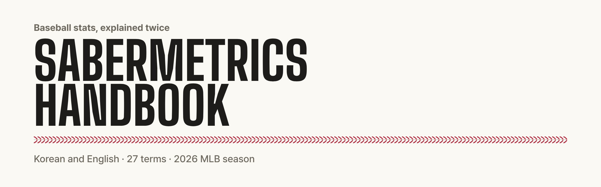
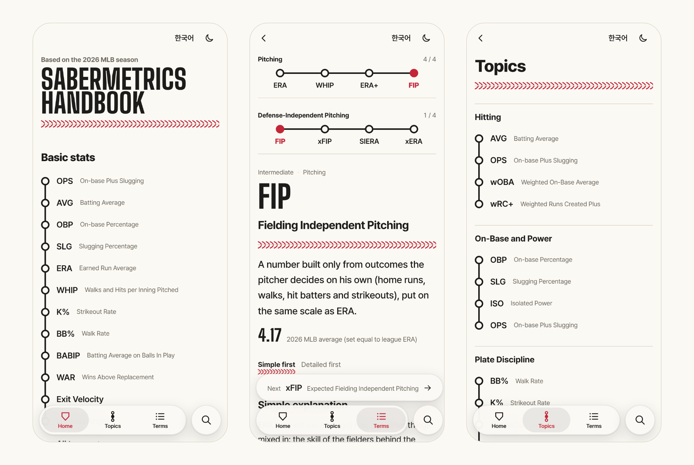

<a href="https://sabermetrics-handbook.pages.dev/en/">
  <picture>
    <source media="(prefers-color-scheme: dark)" srcset=".github/assets/banner-dark.png">
    
  </picture>
</a>

<p align="center">
  <a href="https://sabermetrics-handbook.pages.dev/en/"><b>Open the handbook</b></a> ·
  <a href="https://sabermetrics-handbook.pages.dev/">한국어</a> ·
  <a href="README.ko.md">README in Korean</a> ·
  <a href="CONTRIBUTING.md">Contributing</a>
</p>

<p align="center">
  <a href="https://sabermetrics-handbook.pages.dev/en/"></a>
  
  
  <a href="https://astro.build"></a>
  
</p>

A glossary of baseball stats, from batting average to swing timing. Every term is written twice: a simple explanation for someone meeting the number for the first time, and a detailed one for someone who already uses it and wants to know how it works and where it breaks. The site reads the same in Korean and English.

<picture>
  <source media="(prefers-color-scheme: dark)" srcset=".github/assets/screens-en-dark.png">
  
</picture>

## What's inside

- **Two layers per term.** A simple explanation and a detailed one, with a switch for which comes first. The choice is remembered.
- **Topics.** Related terms lined up from basic to advanced, so you can keep going one step at a time (ERA → FIP → xFIP → SIERA).
- **Benchmarks.** A scale with the 2026 MLB average and rough ranges for good and bad. Every number links to its source.
- **Recent Statcast metrics.** Bat speed, swing length, attack direction, arm angle, swing timing and the 2026 ABS challenge, along with the classics.
- **Korean and English, light and dark.** Switch language on any page and land on the same term. Dark mode is pitch black.
- **Installs like an app.** Tap “Install app” in the settings (on iPhone it shows how to add it to the Home Screen). Once installed, every page, font and search works without a connection, and long-pressing the icon jumps to Topics, Terms or the other language. Android and iOS wrappers use the same build.

## Terms

62 terms in 18 topics. A term can sit in more than one topic.

| Topic | From basic to advanced |
| --- | --- |
| Hitting | AVG → OPS → wOBA → wRC+ |
| On-Base and Power | OBP → SLG → ISO → OPS |
| Plate Discipline | BB% → K% → Chase% → Whiff% |
| Contact Quality | Exit Velocity → Launch Angle → HardHit% → Sweet Spot% → Barrel |
| Luck vs. Skill | BABIP → xBA → xwOBA → xERA |
| The Swing | Bat Speed → Swing Length → Blast → Attack Angle → Swing Timing |
| Swing Path | Attack Angle → Attack Direction → Swing Path Tilt → Squared-Up% |
| Baserunning | Sprint Speed → Baserunning Run Value → BsR |
| Pitching | ERA → WHIP → ERA+ → FIP |
| Defense-Independent Pitching | FIP → xFIP → SIERA → xERA |
| Strikeouts and Whiffs | K% → K-BB% → CSW% → Whiff% |
| Pitch Quality | Velocity → Spin Rate → IVB → VAA → Stuff+ |
| Release and Spin | Extension → Arm Angle → Spin Rate → Active Spin |
| Pitch Models | Stuff+ → Location+ → Pitching+ |
| Fielding | FPCT → Arm Strength → OAA → DRS → FRV |
| Catcher Defense | Pop Time → Blocking → Framing → ABS Challenge |
| Player Value | wRC+ → WAR |
| Context and Wins | RE24 → WPA → LI |

## Getting started

Node 22.22 or later.

```sh
npm install
npm run dev        # dev server at http://localhost:4321 (English at /en/)
npm run build      # static build to dist/; fails if any content check fails
npm test           # content checks and unit tests, no build needed
npm run check      # type check
```

The Android and iOS projects wrap the same site with [Capacitor](https://capacitorjs.com):

```sh
npm run cap:sync       # app build (dist-app/) copied into android/ and ios/
npx cap open android   # or: npx cap open ios
npm run icons          # regenerate PWA and app icons from assets/icon.svg and public/favicon.svg
```

`main` deploys to Cloudflare Pages. Other branches get preview deployments.

## How it's built

An [Astro](https://astro.build) static site with almost no JavaScript: search, the term filters, the reading-order switch, the dark mode toggle and the back button are the only scripts. Each page is generated twice, at `/` in Korean and at `/en/` in English, from one template.

```
src/content/terms/<id>.json      one term: shared data (level, scale numbers, source URLs) and the Korean text
src/content/en/terms/<id>.json   the English text for the same term
src/content/ladders.json         topics, in the order they appear
src/lib/schema.ts                content schema (zod)
src/lib/validate.ts              cross-file checks, including Korean and English staying in step
src/lib/i18n.ts                  interface text in both languages
src/pages/[...lang]/             home, topics, term list and term pages for both languages
src/scripts/                     search, filters, settings, back (the only client scripts)
src/styles/global.css            design tokens and styles
integrations/                    builds the service worker (dist/sw.js) after each build
docs/content-guide.md            how to write a term (Korean)
docs/verified-facts.md           numbers and definitions checked against sources (Korean)
```

The build stops if anything is off: a missing field, a scale mark out of range, a link to a term that doesn't exist, or an English file whose numbers or sources don't match the Korean one.

## Content rules

- Every explanation is original writing. Nothing is translated or copied from FanGraphs, MLB.com or anywhere else.
- Definitions and formulas link to their original source.
- No real player stats as examples. Examples use made-up numbers.
- No number goes in without a source. League averages name their season, currently the 2026 MLB regular season.

## Contributing

Corrections are the most useful thing you can send. If a number, definition or source looks wrong, [open an issue](../../issues/new/choose) with a link to the source. See [CONTRIBUTING.md](CONTRIBUTING.md) for adding terms and working on the code.

## Roadmap

1. ~~Static site (Astro)~~
2. ~~Installable web app that works offline~~
3. ~~English edition~~
4. Android and iOS apps: projects are set up; device builds and store release are next.
